# Testes manuais — Professor Supervisor (PS.01, PS.02 e PS.03)

Sessão executada em 26/11/2026 por Lucas Martinez Domingues.

## Ambiente

- Backend e front-end rodando localmente (`./mvnw spring-boot:run` e `npm run dev`), com o PostgreSQL e o SeaweedFS do `docker-compose.yml`.
- Versão testada: commit `fa3ae1e` (branch `Q-4-lucas-reencerrar-oferta`, que contém a `main` e os PRs #15, #21, #23, #24, #25 e #27).
- Dados do `DataInitializer`:
  - `alevada` supervisiona `jlima` em "Algoritmo e Estrutura de Dados I", com **plano enviado**;
  - `aendo` supervisiona `bcosta` em "Desenvolvimento Web I", com **relatório enviado** (frequência informada pela aluna: 85%);
  - `mnaldi` não supervisiona nenhum aluno.
- Entre os casos de frequência 100 e 0 (CT-14 e CT-15), a API foi reiniciada para devolver a inscrição da `bcosta` ao status "relatório enviado".

## Critérios usados

- **Classes de equivalência:** entradas válidas e inválidas de cada campo (parecer preenchido, vazio, só com espaços; nota escolhida ou não).
- **Análise de valor-limite:** frequência de 0 a 100% (PS.03 RN-3), testando -1, 0, 100 e 101.
- **Pré-condição de status:** a ação só aparece no status exigido pela story (PS.02 PC-2, PS.03 PC-2).
- **Controle de acesso (RNG-1):** acessar pela URL a tela de um aluno de outro supervisor, e a tela do supervisor com o perfil de aluno.

## Casos

Cada caso tem um print. A seção [Evidências](#evidências), no fim, mostra todos eles com o que observar em cada um.

| ID | Story / regra | Critério | Entrada | Resultado esperado | Resultado obtido | Situação | Evidência |
|---|---|---|---|---|---|---|---|
| CT-01 | PS.01 RN-1, RN-2, RN-3 | Classe válida | Login como `alevada` | Lista a oferta com o aluno, o status e o botão de ação | "Algoritmo e Estrutura de Dados I" com João Lima, "Plano enviado" e o botão "Aprovar plano" | Passou | [ps01-ct01](evidencias/ps01-ct01-painel-supervisor.jpg) |
| CT-02 | PS.01 RN-2 | Valor-limite (0 alunos) | Login como `mnaldi` | Nenhuma oferta listada, sem erro | "Nenhuma oferta associada a você." | Passou | [ps01-ct02](evidencias/ps01-ct02-sem-supervisionados.jpg) |
| CT-03 | PS.02 RN-2 | — | Abrir "Aprovar plano" do João Lima | Nome do aluno e dados do plano, só leitura | Nome, código, disciplina, curso, data de envio e o PDF, sem campos editáveis | Passou | [ps02-ct03](evidencias/ps02-ct03-dados-do-plano.jpg) |
| CT-04 | PS.02 RN-3 (parecer obrigatório) | Classe inválida (vazio) | Parecer vazio → "Aprovar plano" | Envio bloqueado | O navegador bloqueou: "Preencha este campo." | Passou | [ps02-ct04](evidencias/ps02-ct04-parecer-vazio.jpg) |
| CT-05 | PS.02 RN-3 e RNG-2 | Classe inválida (só espaços) | Parecer com 3 espaços → "Aprovar plano" | Aprovação recusada, com uma mensagem clara de que o parecer é obrigatório | Aprovação recusada, mas a mensagem exibida foi "Validation failed.", em inglês e sem dizer qual campo | **Falhou** | [ps02-ct05](evidencias/ps02-ct05-parecer-so-espacos.jpg) |
| CT-06 | PS.02 RN-3 (botão Cancelar) | — | Procurar "Cancelar" no formulário; clicar em "Voltar" | Formulário com os botões "Aprovar" e "Cancelar"; cancelar volta sem alterar | Não existe "Cancelar" no formulário. O "Voltar" do topo da página volta ao painel sem alterar o status | **Falhou** | [ps02-ct06](evidencias/ps02-ct06-voltar-sem-aprovar.jpg) |
| CT-07 | PS.02 RN-4 | Classe válida | Parecer preenchido → "Aprovar plano" | Status "plano aprovado", dados salvos e timestamp registrado | "Plano de trabalho aprovado.", status "Plano aprovado" e o histórico com 26/11/2026 10:56:27 | Passou | [ps02-ct07](evidencias/ps02-ct07-plano-aprovado.jpg) |
| CT-08 | PS.02 PC-2 | Pré-condição | Voltar ao painel depois de aprovar | O botão "Aprovar plano" não aparece mais | O status mostra "Plano aprovado" e a ação virou "Ver detalhes" | Passou | [ps02-ct08](evidencias/ps02-ct08-painel-apos-aprovacao.jpg) |
| CT-09 | PS.01 e PS.03 RN-1, RN-2 | — | Login como `aendo` → "Aprovar relatório" da Beatriz Costa | Botão "Aprovar relatório"; tela com o nome, o plano, o relatório e o histórico, só leitura | Botão presente; a tela mostra o plano, o relatório (frequência informada de 85%) e o histórico | Passou | [ps03-ct09a](evidencias/ps03-ct09a-painel-relatorio-enviado.jpg), [ps03-ct09b](evidencias/ps03-ct09b-dados-do-relatorio.jpg) |
| CT-10 | PS.03 RN-3 (frequência vem do aluno) | — | Abrir o formulário do PS.03 | Campo "Frequência" já preenchido com 85 | Campo vazio | **Falhou** | [ps03-ct10](evidencias/ps03-ct10-frequencia-nao-preenchida.jpg) |
| CT-11 | PS.03 RN-3 (nota obrigatória) | Classe inválida (sem nota) | Parecer e frequência 90, sem nota → "Aprovar relatório" | Envio bloqueado | O navegador bloqueou: "Selecione um item da lista." | Passou | [ps03-ct11](evidencias/ps03-ct11-nota-vazia.jpg) |
| CT-12 | PS.03 RN-3 (0 a 100%) | Valor-limite inferior inválido | Frequência -1 | Envio bloqueado | "O valor deve ser maior ou igual a 0." | Passou | [ps03-ct12](evidencias/ps03-ct12-frequencia-menos-1.jpg) |
| CT-13 | PS.03 RN-3 (0 a 100%) | Valor-limite superior inválido | Frequência 101 | Envio bloqueado | "O valor deve ser menor ou igual a 100." | Passou | [ps03-ct13](evidencias/ps03-ct13-frequencia-101.jpg) |
| CT-14 | PS.03 RN-3, RN-4 | Valor-limite superior válido | Parecer, frequência 100 e nota B | Status "relatório aprovado pelo supervisor" e timestamp registrado | "Relatório aprovado.", o status e o histórico com 26/11/2026 10:57:44 | Passou | [ps03-ct14](evidencias/ps03-ct14-frequencia-100-aprovado.jpg) |
| CT-15 | PS.03 RN-3, RN-4 | Valor-limite inferior válido | Parecer, frequência 0 e nota E | Aprovação aceita | "Relatório aprovado." e o status "Relatório aprovado pelo supervisor" | Passou | [ps03-ct15a](evidencias/ps03-ct15a-frequencia-0-preenchido.jpg), [ps03-ct15b](evidencias/ps03-ct15b-frequencia-0-aprovado.jpg) |
| CT-16 | RNG-1 (controle de acesso) | Acesso indevido | `alevada` abre a URL `/professor/supervisor/ofertas/4/alunos/10` (aluna do `aendo`) | Acesso negado | "Você não é o supervisor deste aluno nesta oferta." | Passou | [acesso-ct16](evidencias/acesso-ct16-outro-professor.jpg) |
| CT-17 | RNG-1 (controle de acesso) | Acesso indevido | Aluna `lferreira` abre `/professor/supervisor/ofertas/1/alunos/9` | Acesso negado | Redirecionada para a página inicial, sem ver os dados | Passou | [acesso-ct17](evidencias/acesso-ct17-aluno-na-tela-do-supervisor.jpg) |

## Resumo

- **17 casos:** 14 passaram e 3 falharam.
- **Falhas registradas como bugs:**
  - CT-05: mensagem de erro genérica "Validation failed." quando o parecer só tem espaços — [#30](https://github.com/gustavobragaia/pescd-system/issues/30);
  - CT-06: o formulário do PS.02 (e o do PS.03) não tem o botão "Cancelar" — [#29](https://github.com/gustavobragaia/pescd-system/issues/29);
  - CT-10: a frequência do PS.03 não vem preenchida com o valor do aluno — [#28](https://github.com/gustavobragaia/pescd-system/issues/28).

## Observações

- A validação de faixa da frequência (CT-12 e CT-13) é feita pelo navegador (`min` e `max` do campo). O backend também valida (`@Min(0)` e `@Max(100)` no `ApproveReportFormDTO`).
- O plano de trabalho da Beatriz Costa, em "Desenvolvimento Web I", mostra a disciplina "Algoritmo e Estrutura de Dados I". Isso vem dos dados de exemplo do `DataInitializer`, que usa a mesma disciplina para todos os planos, e não do sistema.
- No CT-17, o acesso é negado, mas sem nenhuma mensagem: o aluno só é levado para a página inicial.

## Evidências

Os prints de cada caso, na ordem da tabela. O usuário logado aparece no canto superior direito de cada tela.

| Usuário | Papel nos testes |
|---|---|
| `alevada` | supervisor do aluno João Lima (plano enviado) |
| `aendo` | supervisor da aluna Beatriz Costa (relatório enviado, frequência informada de 85%) |
| `mnaldi` | professor sem alunos supervisionados |
| `lferreira` | aluno |

### PS.01

**CT-01 — painel do supervisor** (`alevada`). A oferta aparece com o aluno João Lima, o status "Plano enviado" e o botão "Aprovar plano".

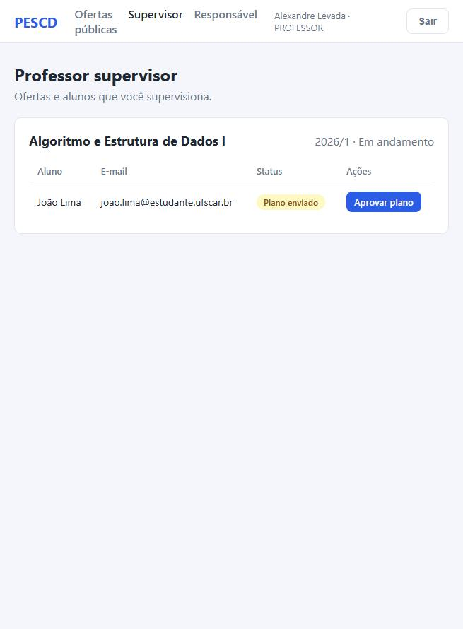

**CT-02 — professor sem alunos supervisionados** (`mnaldi`). A tela mostra "Nenhuma oferta associada a você.", sem erro.

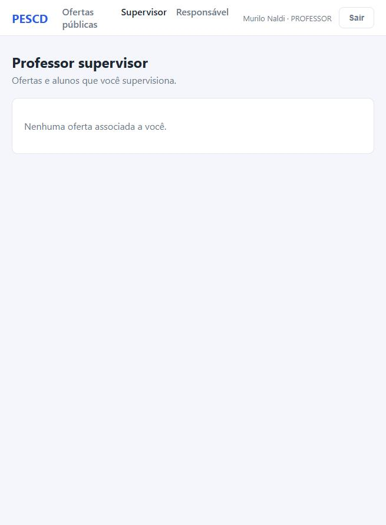

### PS.02

**CT-03 — tela de aprovação do plano.** O nome do aluno aparece no topo e os dados do plano vêm como texto, sem campos editáveis. Abaixo, o formulário com o parecer.

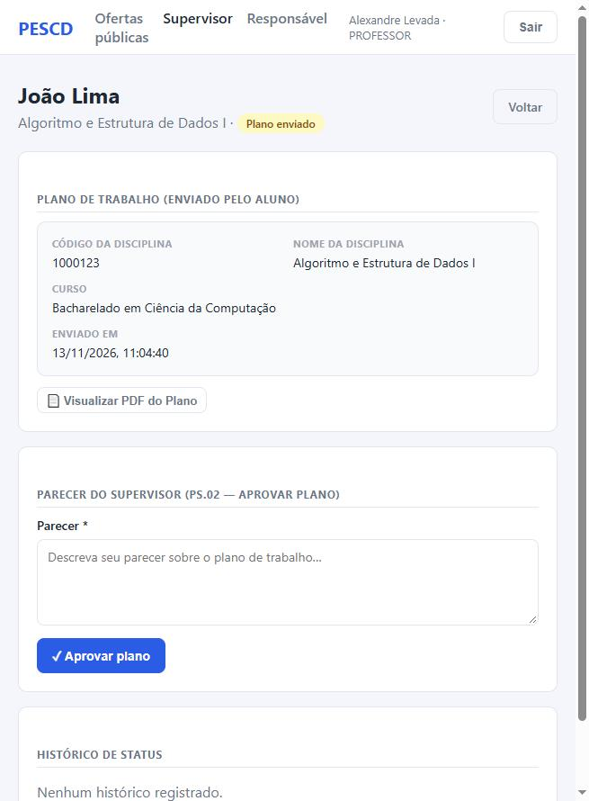

**CT-04 — parecer vazio.** O navegador bloqueia o envio com "Preencha este campo.".

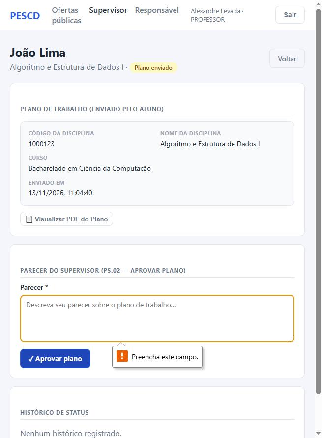

**CT-05 — parecer só com espaços (falhou, #30).** A aprovação é recusada (o status continua "Plano enviado"), mas a mensagem no topo é "Validation failed.", em inglês e sem indicar o campo.

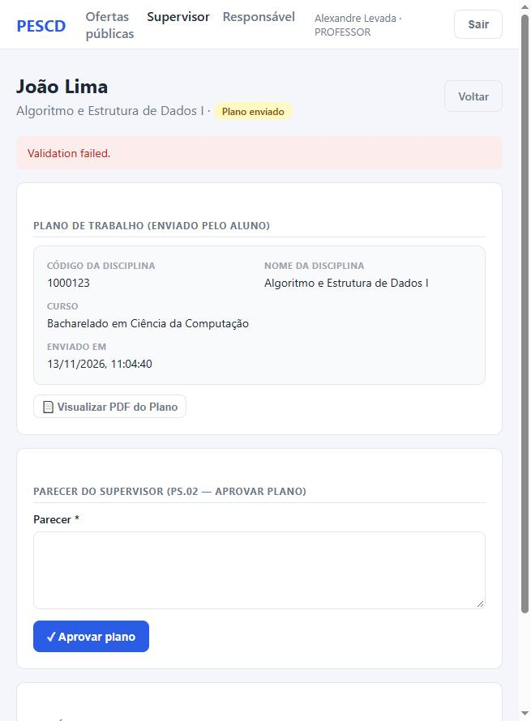

**CT-06 — botão Cancelar (falhou, #29).** O formulário do CT-03 só tem o botão "Aprovar plano". O print mostra o painel depois de usar o "Voltar" do topo da página: o status continua "Plano enviado", sem alteração.

**CT-07 — aprovar com parecer.** Aparece "Plano de trabalho aprovado.", o status muda para "Plano aprovado", o formulário some e o histórico registra a mudança com data e hora.

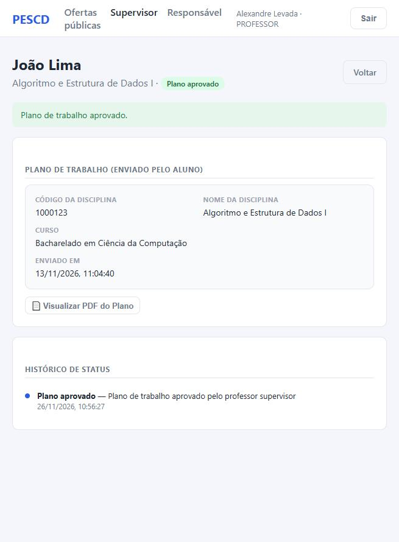

**CT-08 — painel depois da aprovação.** O status é "Plano aprovado" e a ação virou "Ver detalhes": o botão "Aprovar plano" não aparece mais.

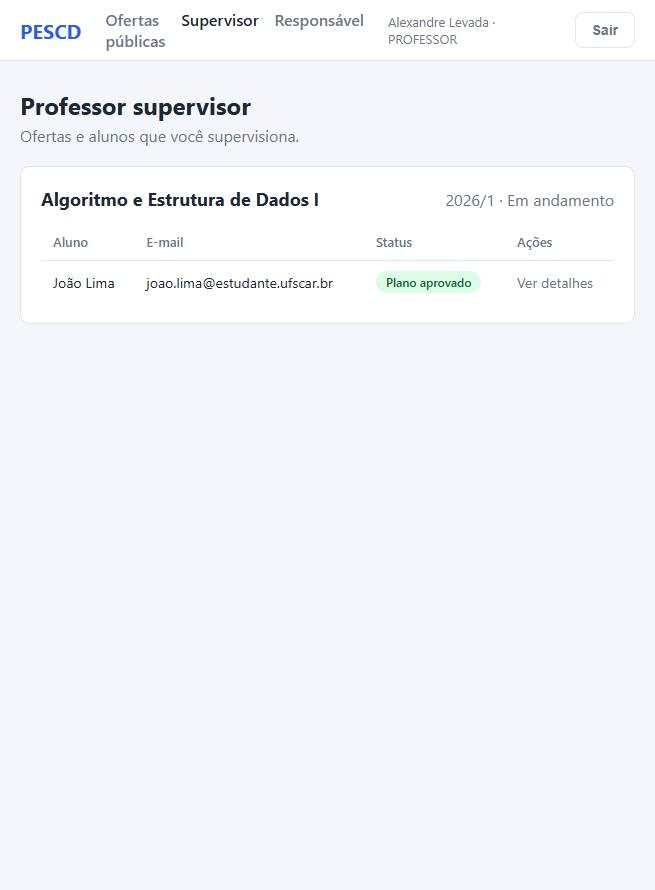

### PS.03

**CT-09 — painel e tela do relatório** (`aendo`). No painel, a Beatriz Costa aparece com "Relatório enviado" e o botão "Aprovar relatório". Na tela, os blocos do plano e do relatório, com a frequência indicada pela aluna (85%).

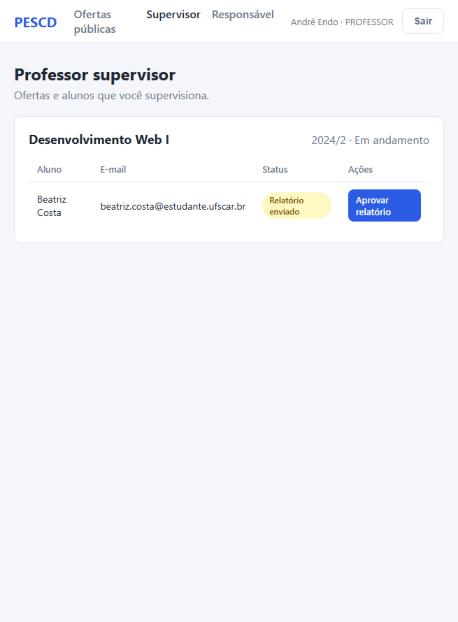

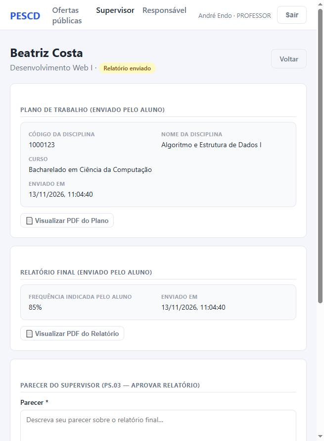

**CT-10 — frequência não preenchida (falhou, #28).** A aluna informou 85%, mas o campo "Frequência confirmada (%)" do formulário vem vazio.

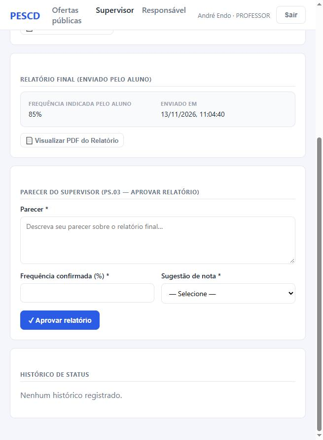

**CT-11 — sem sugestão de nota.** Com o parecer e a frequência preenchidos e a nota em "— Selecione —", o navegador bloqueia com "Selecione um item da lista.".

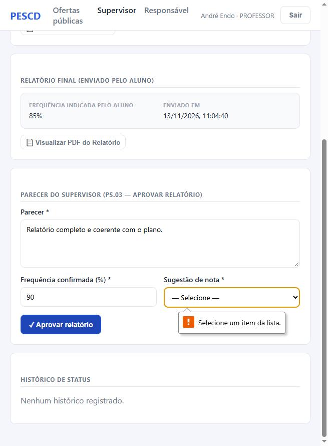

**CT-12 — frequência -1.** Bloqueada com "O valor deve ser maior ou igual a 0.".

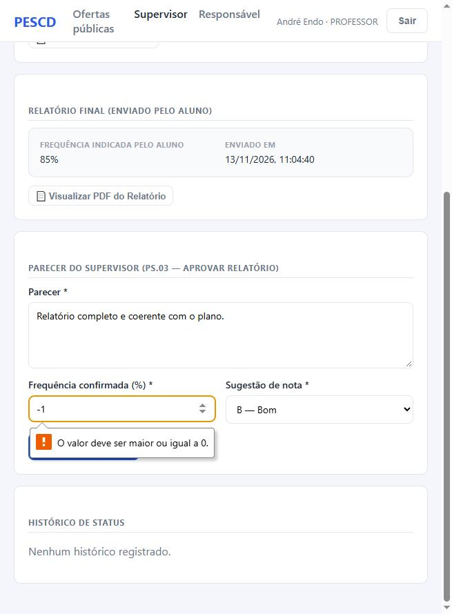

**CT-13 — frequência 101.** Bloqueada com "O valor deve ser menor ou igual a 100.".

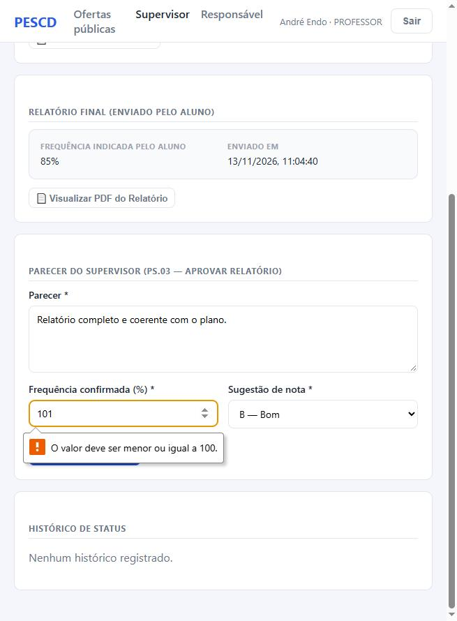

**CT-14 — frequência 100.** O relatório é aprovado: "Relatório aprovado.", o status "Relatório aprovado pelo supervisor" e o registro no histórico.

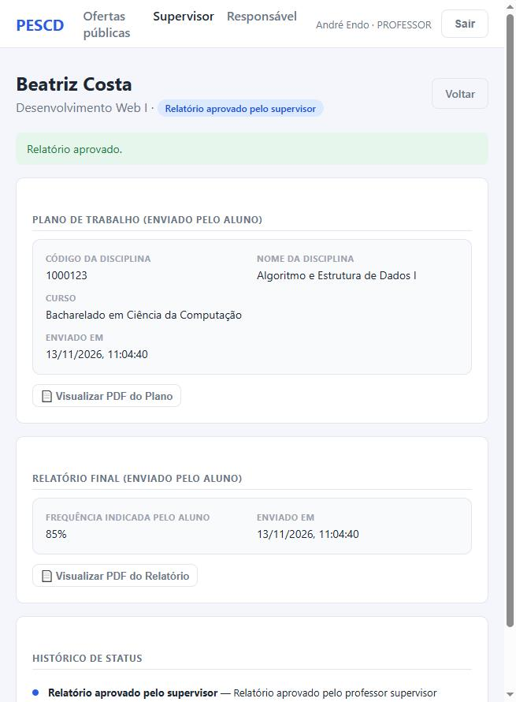

**CT-15 — frequência 0.** Formulário preenchido com frequência 0 e nota E (primeiro print) e a aprovação aceita (segundo print). Antes deste caso, a API foi reiniciada para a inscrição voltar a "Relatório enviado".

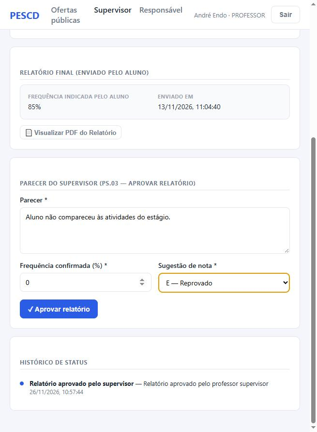

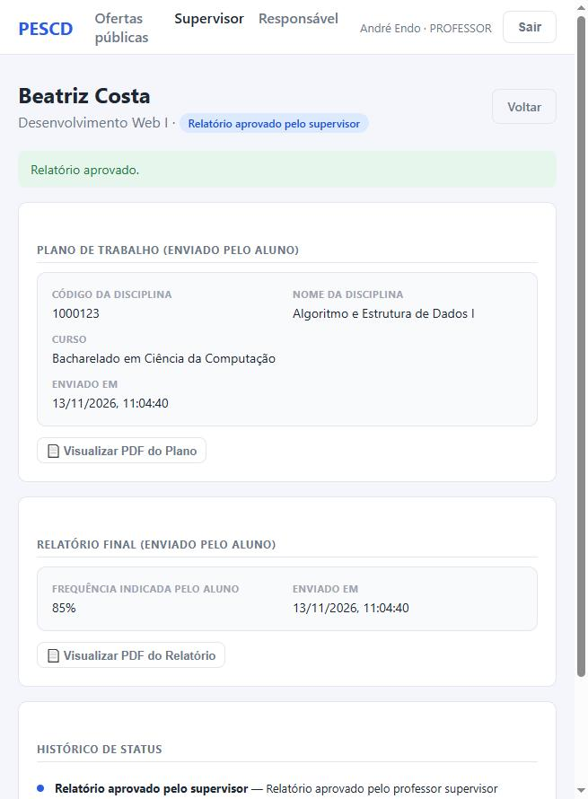

### Controle de acesso

**CT-16 — professor abrindo a aluna de outro supervisor.** `alevada` digitou a URL da Beatriz (`/professor/supervisor/ofertas/4/alunos/10`). A tela só mostra "Você não é o supervisor deste aluno nesta oferta.", sem nenhum dado da aluna.

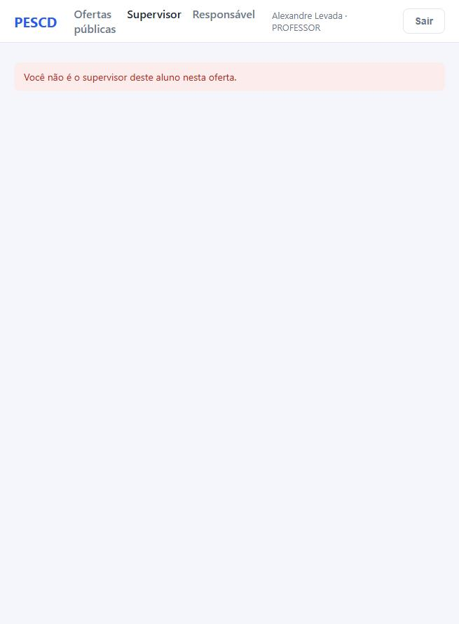

**CT-17 — aluno abrindo a tela do supervisor.** Logada como `lferreira` ("Lucas Ferreira · ALUNO"), a aluna digitou a URL da tela do supervisor e foi levada para a página inicial, sem ver os dados.

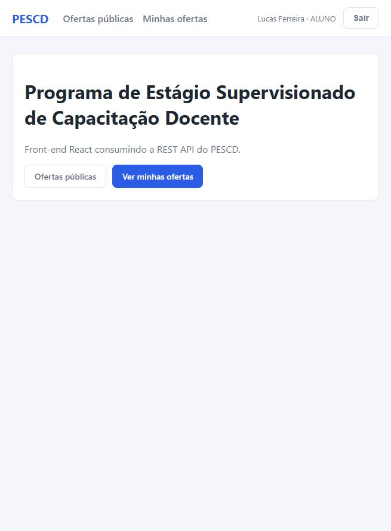
